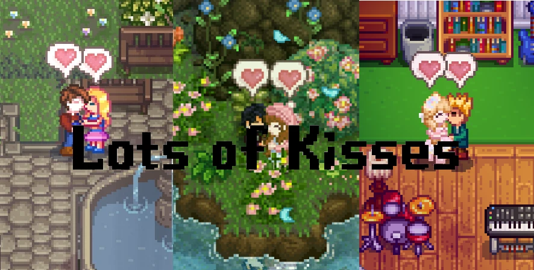

# Lots of Kisses



Bring more affection, playfulness, and romance to your Stardew Valley relationships.

This mod expands the ways you can interact with your spouse or romantic partner. Share quick kisses, enjoy longer affectionate moments, and see how nearby villagers react.

## Main Features

- **Bump Kiss** — gently bump into your partner to give them a quick kiss.
- **Multi-Kiss** — stay close and enjoy a longer sequence of kisses.
- **Bystander Reactions** — nearby NPCs may notice and react when they see you kissing.
- **Partner Reactions** — your partner may become embarrassed and comment during romantic moments in public.
- **Spouses and Dating Partners** — enjoy affectionate interactions both before and after marriage.
- **Polyamory Compatible** — supports multiple romantic partners when used with polyamory mods.
- **Custom NPC Support** — romanceable NPCs added by other mods can also participate.
- **Custom Dialogue Packs** — add dialogue for different characters and languages.

NPCs without custom dialogue are still supported, so you can kiss them normally even when no character-specific dialogue pack is installed.


## Installation

1. Install [SMAPI](https://smapi.io/).
2. Download and extract Lots of Kisses into your `Stardew Valley/Mods` folder.
3. Launch Stardew Valley through SMAPI and have fun!

## Requirements

- Stardew Valley 1.6 or later
- SMAPI 4.0.0 or later

### Optional

- [Generic Mod Config Menu](https://www.nexusmods.com/stardewvalley/mods/5098) — customize the mod's settings from inside the game.
- [Tile Marker](https://www.nexusmods.com/stardewvalley/mods/49175) — mark counters, tables, chairs, decorations, or other objects that should not block an NPC's line of sight. It only changes how Lots of Kisses checks visibility; it does not modify maps, furniture, or collisions.

### Player-to-Player Marriage — Experimental

The mod includes experimental support for multiplayer couples where one farmer is married to another farmer. It works in split-screen and online co-op, with support for Bump Kisses, automatic Multi-Kisses, and manual kiss options.

For the best results, both players should use the same version of Lots of Kisses. Players can choose whether to accept kisses from their farmer spouse through Generic Mod Config Menu.

As this feature is experimental, small visual or synchronization issues may occasionally happen depending on the platform or connection. If you find a problem, please send your full SMAPI log and say whether you were playing online or in split-screen.

---

## Content Packs

Lots of Kisses supports content packs for adding kiss dialogue for any NPC.

### Structure

```
[LoK] Your Pack Name/
├── manifest.json
├── en.json
└── pt.json        ← optional, add other locales as needed
```

### manifest.json

```json
{
  "Name": "Lots of Kisses - Your Pack Name",
  "Author": "YourName",
  "Version": "1.0.0",
  "Description": "Kiss dialogue for ...",
  "UniqueID": "YourName.LotsOfKisses.YourPackName",
  "ContentPackFor": {
    "UniqueID": "NatrollEXE.LotsOfKisses"
  },
  "MinimumApiVersion": "4.0.0",
  "UpdateKeys": []
}
```

### Dialogue keys

Every dialogue key ends with a positive number. There is no fixed maximum, and the numbers do not need to be consecutive, so a pack may use keys such as `.1`, `.25`, and `.250` without filling the gaps.

Use the NPC's exact internal name in NPC-specific keys. The main supported patterns are:

- `approachKiss.<InternalName>.<number>`
- `OutdoorKisses.<InternalName>.<number>`
- `IndoorKisses.<InternalName>.<number>`
- `kissReaction.<InternalName>.<number>`
- `PublicKissReaction.<InternalName>.<number>`
- `Reaction<InternalName>.<number>` for a bystander's personalized reaction
- `CrowdReaction.<number>` for generic adult reactions
- `CrowdReaction.Child.<number>` for child reactions

### Note

NPCs without a content pack still work fully — kisses happen normally, just without custom dialogue.
