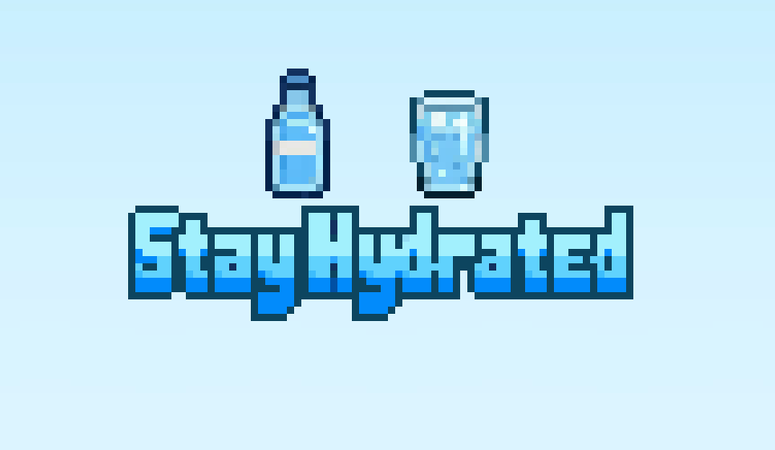

# Stay Hydrated!

This mod adds a glass and a bottle of ice-cold water to the game. Drink some water to restore energy and gain a temporary [Freshness buff](#freshness-buff) that helps you spend less energy while using tools.

## Freshness Buff

- **Glass of Iced Water:** +1 Freshness for 2 real minutes and 5% less energy spent when using tools by default.
- **Bottle of Iced Water:** +2 Freshness for 4 real minutes and 10% less energy spent when using tools by default.

You can change the energy-saving percentages in Stay Hydrated!'s Generic Mod Config Menu settings.

## How to Get Water

- Buy bottles from **Gus for 50g** or **Pierre for 100g**.
- Collect a free glass of water from sinks you marked with [Tile Marker](../TileMarker). You can choose a keyboard, mouse, or controller button in Tile Marker's Generic Mod Config Menu settings.

## Weather Wonders Integration

If Weather Wonders is installed, drinking water during a heatwave protects you from the intense heat while the Freshness buff is active. It prevents both the maximum-energy penalty and the continuous energy drain. Both drinks provide full protection; the bottle simply lasts longer.

## Requirements

- SMAPI
- Content Patcher
- Tile Marker 1.1.1 or later (required for collecting water from marked sinks)

Generic Mod Config Menu is optional for changing the button and energy-saving percentages. Weather Wonders is optional and enables heatwave protection.
